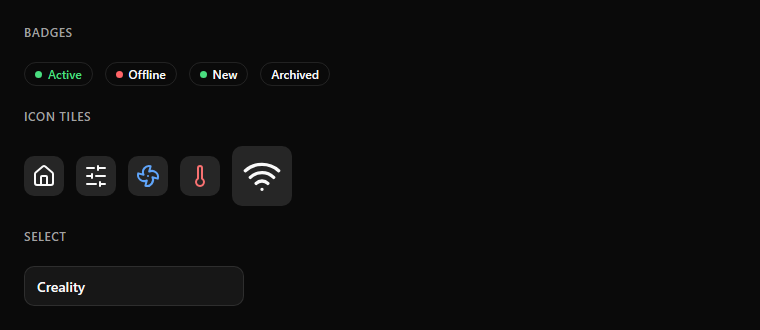

# Badge, icon tile and select

**Badge:** a pill 24 px high with a 1 px border and a 12 px label. An optional 7 px dot carries the state color.
Typical badges: `Active` (green), `Offline` (red dot), `New` (green dot), `Archived` (no dot).

**Icon tile:** a square of 40–64 px, `secondary` background, radius 10, with a tinted icon (60–64 % of the tile size).
Use 60 px tiles in menu cards and 40 px tiles in lists and temperature cards.

**Select:** a 40 px high outline button with the value on the left and a chevron on the right. Tapping it opens a list of
options in a dialog or a dropdown.
