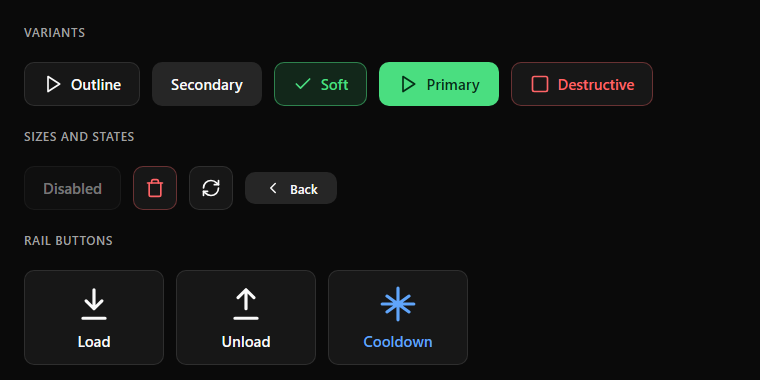

# Buttons

| Variant | Background | Border | Text | Use |
|---|---|---|---|---|
| Outline | `card` | `border` | `foreground` | Normal action |
| Secondary | `secondary` | none | `foreground` | Neutral action, Back pill |
| Soft | `accent` 14 % | `accent` 50 % | `accent` | Selected, or a positive action that is not the main one |
| Primary | `accent` | none | `#052E16` | The main action of the screen. **One per screen** |
| Destructive | `card` | `destructive` 35 % | `destructive` | Stop, delete, emergency stop |

**Sizes:** radius 10; height 44, 52 or 60 px (32 px for the Back pill). The icon is 20–24 px with an 8 px gap before the label.
Icon-only buttons are square (44 or 52 px).

**States:** disabled uses 45 % opacity; pressed darkens the button's own background. A hover state does not exist on a touch display.

**Rail button:** a taller button (95–140 px) in a side column. A 38–44 px icon sits above a title-case label, centered.

**Labels:** title case (`Manual color`, `Cooldown`), never all caps. Say what the action does (`Home All`, not `Home`).
