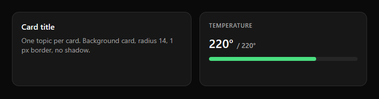

# Card

The card is the basic container of PowerUI. One card holds one topic.

| Property | Value |
|---|---|
| Background | `card` `#171717` |
| Border | 1 px, `border` (white at 10 %) |
| Radius | 14 |
| Shadow | none |
| Padding | 16–20 |

**Rules**
- Do not nest cards. Group inside a card with spacing and a small uppercase label (12 px, bold, `muted`).
- A selected or active card may use the soft accent (background `accent` at 8–14 %, border `accent` at 50 %).
- Cards never overlap; keep 12 px between cards.
