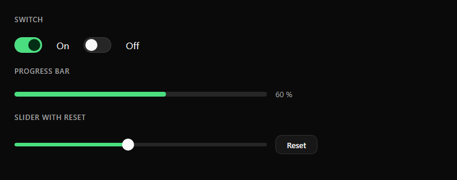

# Switch, slider and progress bar

| Control | Spec |
|---|---|
| Switch | 46 × 26 px. On: `accent` track, `#052E16` knob. Off: `secondary` track, `foreground` knob |
| Progress bar | 8 px high (4–6 px inside small cards), track `secondary`, indicator `accent`, rounded ends |
| Slider | Same track as the progress bar plus a 20 px round `foreground` knob |
| Reset | A small outline text button (32 px high) to the right of a slider, restoring the original value |

**Rules**
- A switch changes the setting immediately; there is no Save button for it.
- Show the current value next to a slider (right aligned, 13 px).
- A bar that shows temperature uses the series color of that value instead of the accent.
