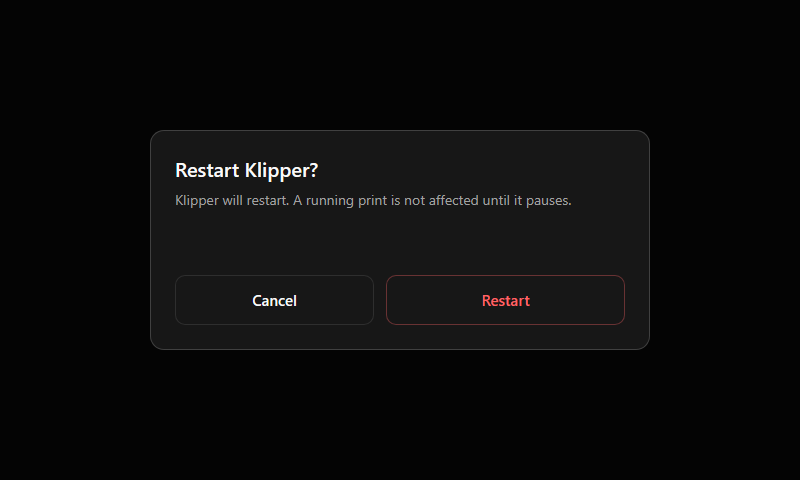

# Dialog

A dialog asks for a decision and always covers the whole screen with an overlay.

| Property | Value |
|---|---|
| Overlay | Black at 60 % over the whole screen |
| Card | Centered, 500 px wide, `card` background, radius 14, border white at 18 % |
| Title | 20 px, bold |
| Text | 14 px, `muted`, one or two short sentences |
| Buttons | Two, 50 px high. Cancel on the left (outline); the action on the right (primary, or destructive for dangerous actions) |

**Rules**
- Name the action in the button (`Restart`, `Delete`), never `OK`.
- Tapping outside the card does not confirm anything.
- Use a destructive action button for anything that cannot be undone.
