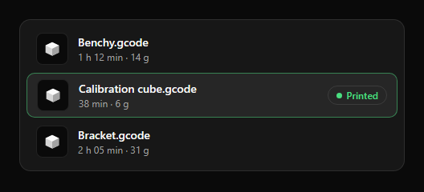

# List row

| Property | Value |
|---|---|
| Height | 56 px |
| Thumbnail / icon | 40 px at the left, 12 px gap |
| Title | 14 px, bold |
| Detail | 12 px, `muted` |
| Trailing | Optional badge or value, right aligned |
| Selected | `secondary` background and a 1 px `accent` border (50 %) |

**Rules**
- Rows are separated by space (2 px), not by lines.
- Long names are cut with an ellipsis; never wrap a title into two lines.
- A list scrolls inside its card; the card does not grow.
