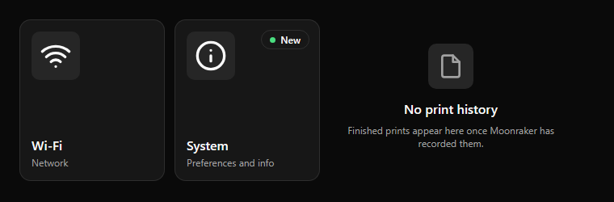

# Menu card and empty state

**Menu card** (used in menu screens): a card with a 60 px icon tile at the top left, an optional badge at the top right, and a
bold 16 px title with a 12 px `muted` description at the bottom left. Menus use four columns and two rows with a 12 px gap.
A disabled entry uses 45 % opacity and a status badge that explains why (for example `Offline`).

**Empty state:** shown instead of a list that has nothing to show. A 56 px icon tile, a 16 px bold title and a 12 px `muted`
description, centered. Explain what will appear there, not that something is missing.
