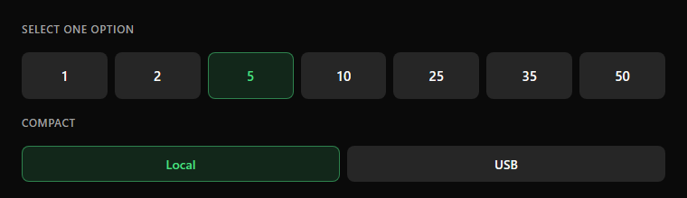

# Segmented group

Choose one option from a short list (up to 8). Items are equal-width buttons in a row.

| Property | Value |
|---|---|
| Item height | 40–52 px |
| Gap | 6–8 px |
| Item radius | 8 |
| Selected | Soft style: `accent` 14 % background, `accent` 50 % border, `accent` text |
| Not selected | `secondary` background, no border |

**Rules**
- The items must read as **separated rounded cells**. If they look like one continuous band, the widget that wraps the group
  is showing its own background (see the [LVGL guide](../implementation/lvgl.md#5-pitfalls-found)).
- Place a 14 px `muted` title above the group, inside the same card.
- Use one group per setting; do not mix units in the same group.
