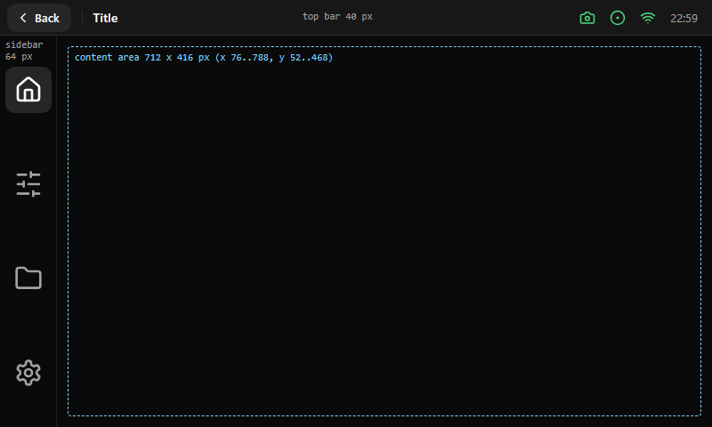

# Screens

Reference layouts of the screen types of a Klipper display, built from the PowerUI [components](../components/README.md).
Every screen uses the same [frame](../foundations/layout.md#frame): a top bar, a sidebar and a content area of 712 × 416 px.

| Screen | Page |
|---|---|
| Home | [home.md](home.md) |
| Menu screens (Settings, Calibrations) | [menu.md](menu.md) |
| Files | [files.md](files.md) |
| Filament | [filament.md](filament.md) |
| Movement | [movement.md](movement.md) |
| Print status | [print-status.md](print-status.md) |

More screens (tools such as input shaper, fans, console, Wi-Fi, system) will be added. The images are rendered by
[`tools/render_reference.py`](../../tools/render_reference.py).
