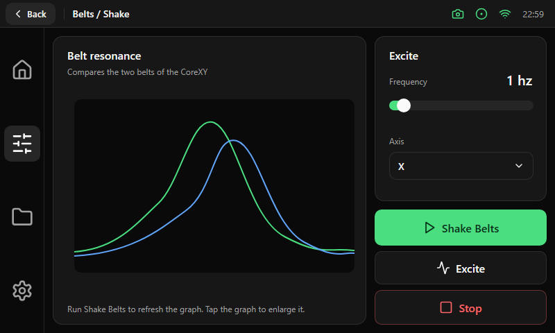

# Belts / Shake

| Area | Size and content |
|---|---|
| Graph card | 452 × 416 px on the left: title (16 pt), a one-line subtitle, a 404 × 250 px graph area and a footer hint at the bottom. Before the first run the area shows "No graph yet"; tapping the graph enlarges it |
| Excite card | 248 × 238 px on the right: title, the frequency (20 pt) with a [slider](../components/controls.md), and an axis [select](../components/badges-tiles-select.md) |
| Actions | Three full-width buttons of 248 px under the card: Primary **Shake Belts** (52 px), Outline **Excite** (48 px) and Destructive **Stop** (50 px) |

The graph compares the resonance of the two belts of a CoreXY, so the two curves share one set of axes and use two different colors from the palette.
