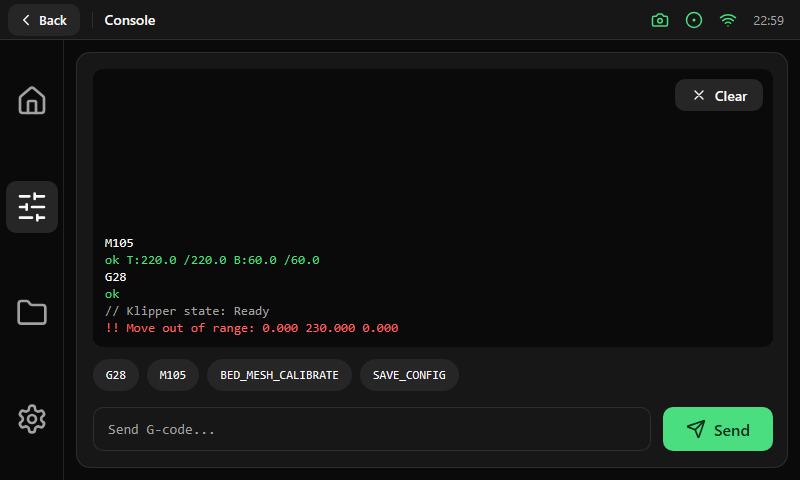

# Console

One card of 712 × 416 px with 16 px of padding and 12 px between its rows.

| Row | Size and content |
|---|---|
| Log | Fills the free height. Monospace 14 pt on the background color, radius 10, 12 px of padding. Short logs hug the bottom. A floating Secondary **Clear** button (88 × 32 px) sits at the top right |
| Shortcuts | A horizontal strip of 36 px with pill buttons (command history and the macros that match what is typed). It scrolls sideways without a scrollbar |
| Input | A text field of 44 px (radius 10, green border when focused, placeholder "Send G-code...") and a Primary **Send** button of 110 × 44 px |

The on-screen keyboard appears over the lower part when the field is focused. Log lines are colored by their start: `//` lines in muted, `!!` lines and any line with "error" in the destructive red, lines that start
with `ok` in green, and everything else (your own commands included) in the foreground color.
