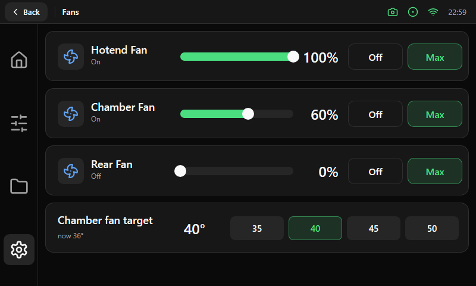

# Fans

| Area | Size and content |
|---|---|
| Fan cards | One card per fan, 712 × 84 px, 12 px gap. Icon tile (44 px), name and state, [slider](../components/controls.md), value in 24 pt, then an Outline **Off** and a Soft **Max** button (92 × 44 px) |
| Target card | Same 712 × 84 px strip for a `temperature_fan` object (for example the chamber fan): title and current temperature on the left, the target in 24 pt, and a 384 px [segmented group](../components/segmented.md) on the right |

The cards are generated from the fan objects the printer reports, so the list grows or shrinks with the machine. The target card only
appears when the printer has that object. There is no title inside the screen: the top bar carries it.
