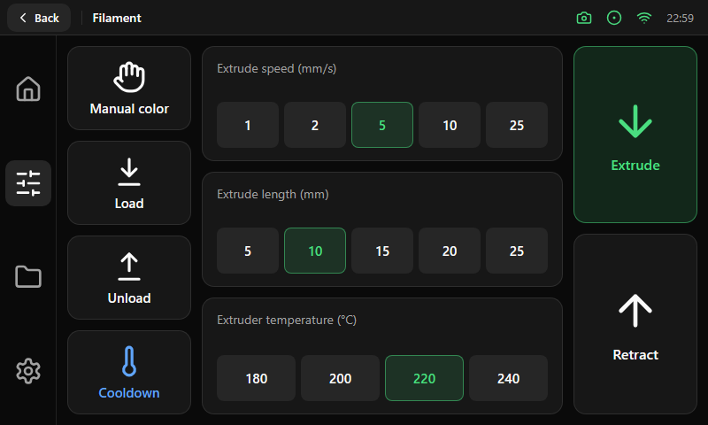

# Filament

| Area | Size and content |
|---|---|
| Left rail | 140 px wide: four rail buttons (Manual color, Load, Unload, Cooldown) of 95 px, 12 px gap |
| Center | Three cards of 408 px, each with a title and a [segmented group](../components/segmented.md) (speed, length, temperature) |
| Right rail | 140 px wide: two large buttons that fill the column, a Soft **Extrude** (200 px high) and an Outline **Retract** (204 px high), with 56 px icons |

The Back pill is in the top bar; the screen has no title of its own. The two big buttons are the actions used most while a spool is changed,
so they get the most room. Anything that opens another screen (for example a filament-box page) belongs in a menu, not in this rail.
