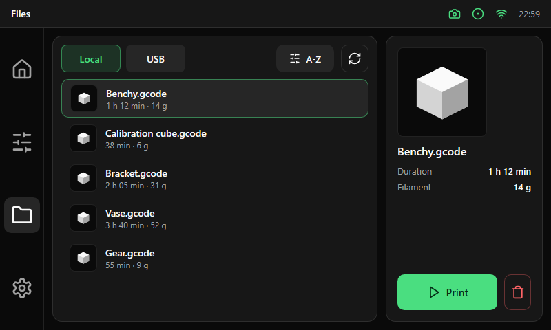

# Files

| Area | Size and content |
|---|---|
| List card (left) | 472 px wide: a Local / USB selector, a sort button and a reload button, then [list rows](../components/list-row.md) |
| Detail card (right) | 228 px wide: preview, name, data rows (duration, filament) and the actions |
| Actions | `Print` (primary) and a destructive icon button for delete, 52 px high |
