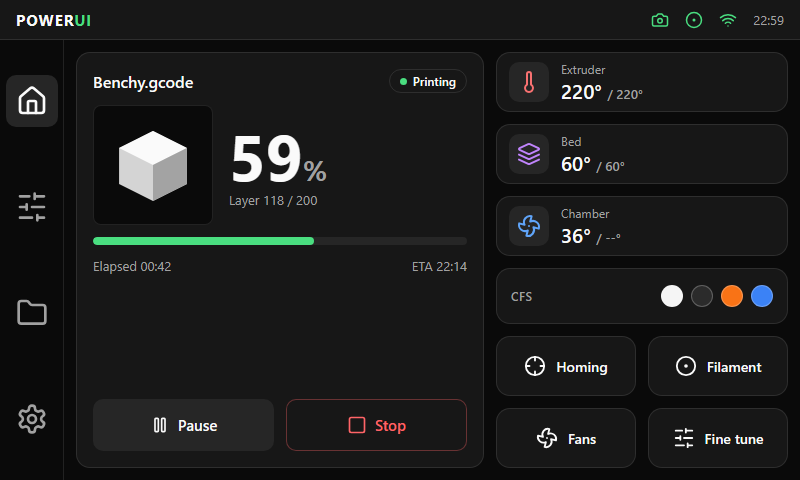

# Home

| Area | Size and content |
|---|---|
| Print card (left) | 408 × 416 px: file name and state badge, preview, large progress number (64–88 px), progress bar, elapsed and ETA, Pause and Stop |
| Temperature cards (right) | Three cards of 292 × 60 px: a 40 px tile with the series color, a label and `current / target` |
| Chip | 292 × 56 px, for example the CFS status with the spool colors |
| Quick buttons | Four buttons of 140 × 60 px in a 2 × 2 grid |

The top bar shows the logo (only here). When the printer is idle, the print card is replaced by a temperature chart.
