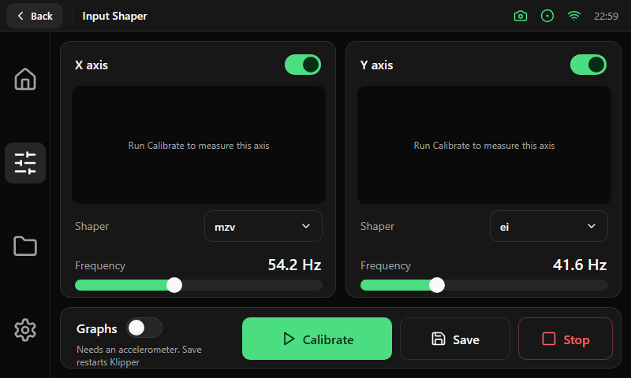

# Input shaper

| Area | Size and content |
|---|---|
| Axis cards | Two cards of 350 × 326 px (X on the left, Y on the right). Each has the axis name and an enable [switch](../components/controls.md), a 322 × 150 px result area, a shaper [select](../components/badges-tiles-select.md) (150 px), the frequency in 20 pt and a slider |
| Result area | Black background, radius 10. Before a measurement it shows the hint "Run Calibrate to measure this axis"; afterwards the resonance graph or the text output. Tapping it enlarges it |
| Bottom bar | A 712 × 78 px card: a **Graphs** switch with a one-line note, then Primary **Calibrate** (190 px), Outline **Save** (140 px) and Destructive **Stop** (120 px), all 54 px high |

Rules worth copying:

- **Save** restarts Klipper, so the note says so next to the switch that needs an accelerometer.
- The slider sets the frequency in tenths of a hertz; the value is shown beside its label, never inside the slider.
- The screen needs no title of its own; the Back pill and the title are in the top bar.
