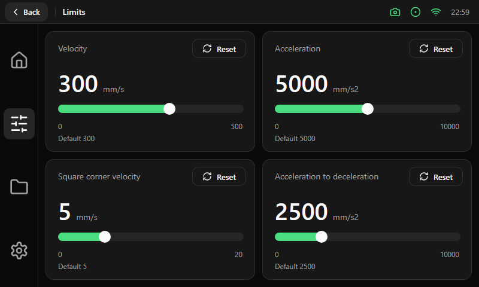

# Limits

Four cards of 350 × 202 px in a 2 × 2 grid with a 12 px gap: velocity, acceleration, square corner velocity and acceleration to deceleration.

| Part of each card | Size and content |
|---|---|
| Title | 14 pt, muted, at the top left |
| Reset | Outline button of 90 × 32 px at the top right; it restores the value that `printer.cfg` defines |
| Value | 40 pt number with the unit (14 pt, muted) beside it |
| Slider | 310 × 14 px, see [controls](../components/controls.md). The new value is sent when the finger is released, not while dragging |
| Range | Minimum and maximum in 12 pt, muted, under the slider |
| Default | "Default N" in 12 pt, muted, at the bottom left |
