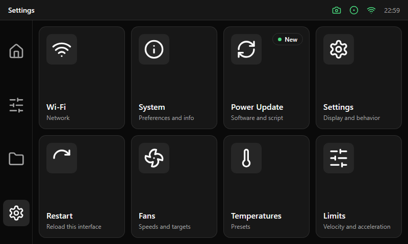

# Menu screens

Used for Settings and Calibrations. A grid of [menu cards](../components/menu-card-and-empty-state.md): four columns by two
rows in the 712 × 416 px content area, 12 px gap. Entries that are not available stay visible with a badge that explains why.
