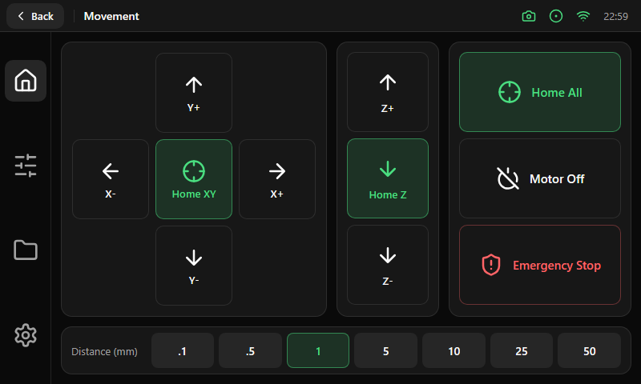

# Movement

| Area | Size and content |
|---|---|
| XY cross | 332 × 344 px card with cells of 96 × 100 px: Y+ above, X- / Home XY / X+ in the middle, Y- below |
| Z column | 128 px wide: Z+, Home Z and Z- (102 × 100 px) |
| Actions | 228 px wide: Home All (soft), Motor Off and Emergency Stop (destructive), 202 × 100 px |
| Distance bar | Full width, 60 px high, a label and a [segmented group](../components/segmented.md) |

Each button has an icon that says what it does: a crosshair for the homing actions, arrows for moves, a slashed power symbol for
Motor Off and a shield for the emergency stop.
