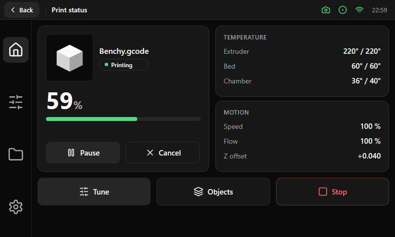

# Print status

| Area | Size and content |
|---|---|
| Job card (left) | 348 × 296 px: preview, name, state badge, large progress, Pause and Cancel |
| Temperature card | 352 × 144 px: extruder, bed and chamber, `current / target` |
| Motion card | 352 × 144 px: speed, flow and Z offset |
| Bottom row | Three buttons of 56 px: Tune, Objects (only when the file has two or more labeled objects) and Stop |
