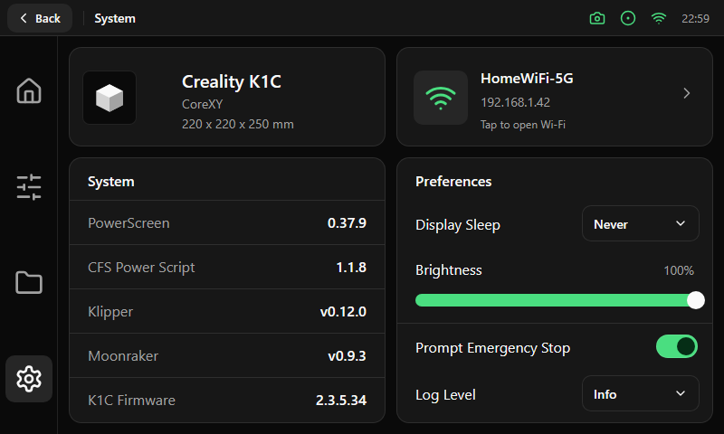

# System

Four cards of 350 px in two columns, 12 px apart.

| Card | Size | Content |
|---|---|---|
| Printer | 350 × 110 px | Picture of the printer (left), model name in 20 pt, kinematics and build size in 14 pt, muted |
| Network | 350 × 110 px | Wi-Fi tile (60 px), network name, IP address and the hint "Tap to open Wi-Fi", with a chevron. The whole card is a button that opens the [Wi-Fi screen](wifi.md) |
| System | 350 × 294 px | Title and five rows of 49 px separated by 1 px hairlines: name in muted 16 pt on the left, value in 16 pt on the right (software and firmware versions) |
| Preferences | 350 × 294 px | Title, then a [select](../components/badges-tiles-select.md) row (Display Sleep), a brightness slider with its percentage, and rows with a [switch](../components/controls.md) or a select (Prompt Emergency Stop, Log Level). Rows are 52 px high with the control 16 px from the right edge |

A second page, **About** (a tab pair at the top of the screen), holds the version cards for the display software and the helper script with their update buttons
of 376 × 48 px. A running update opens a [dialog](../components/dialog.md) with its steps.
