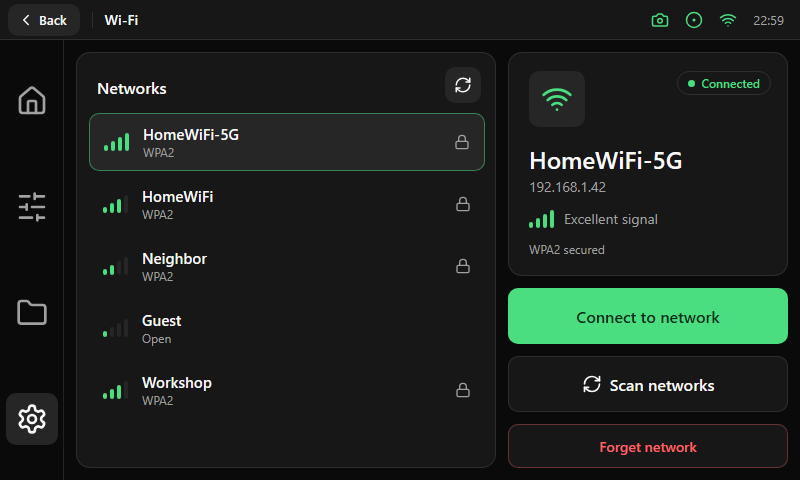

# Wi-Fi

| Area | Size and content |
|---|---|
| Network list | A card of 420 × 416 px: title "Networks" and a 36 px refresh button, then a list of 58 px [rows](../components/list-row.md) with 4 px between them. Each row has signal bars, the network name, its security and a lock when it is secured. The selected row uses the soft green border. With no results the list shows an [empty state](../components/menu-card-and-empty-state.md) |
| Status card | 280 × 224 px: icon tile (56 px), a [badge](../components/badges-tiles-select.md) with the state (Connected, Saved or Not connected), the network name in 24 pt, the IP address, signal bars with a text ("Excellent signal") and the security |
| Actions | Under the status card, 280 px wide: Primary **Connect to network** (56 px), Outline **Scan networks** (56 px) and Destructive **Forget network** (44 px) |

For a secured network that is not saved, the status card swaps its details for a password field (48 px) and the on-screen keyboard opens along the bottom.
The signal bars show four levels; the text beside them reads Excellent, Good, Fair or Weak.
